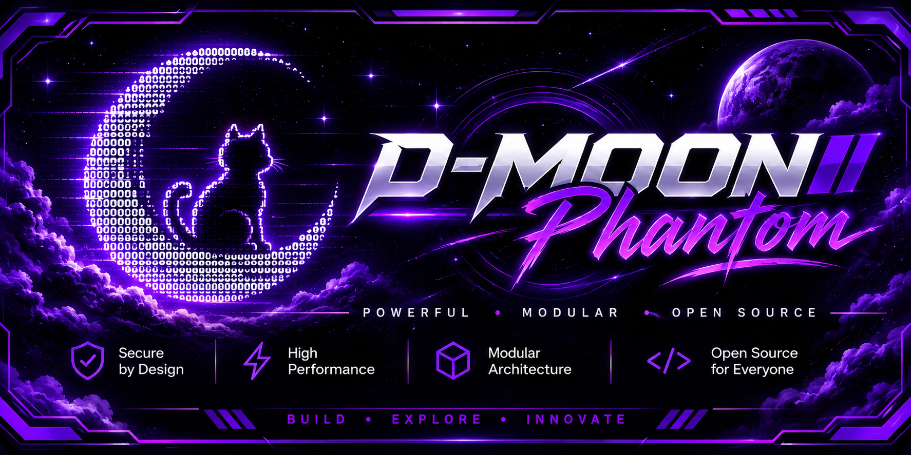
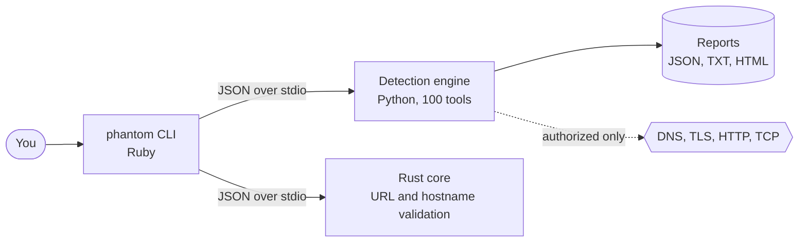

<p align="center">
  
</p>

<p align="center">
  <b>A defensive cybersecurity intelligence suite that runs in your pocket.</b><br>
  100 tools. One CLI. Built for Android (Termux, ARM64) and Linux.
</p>

<p align="center">
  
  
  
  
</p>
<p align="center">
  
  
  
  
  
</p>

<p align="center">
  <a href="#quick-start">Quick start</a> ·
  <a href="#what-you-can-do">What you can do</a> ·
  <a href="#the-100-tools">Tools</a> ·
  <a href="#commands">Commands</a> ·
  <a href="#architecture">Architecture</a> ·
  <a href="#safety-by-design">Safety</a> ·
  <a href="#bahasa-indonesia">Bahasa Indonesia</a>
</p>

---

## What is D-MOON Phantom?

D-MOON Phantom checks links, domains, DNS, TLS certificates, HTTP headers, IP addresses, files and emails
for security problems, then gives you a clear report. It is made for defenders: people who protect their own
sites, servers, inboxes and files, and who want to do it from a phone.

- **No cloud needed.** Most analysis runs fully offline on your device.
- **No guesswork about what a result means.** Every finding says whether it is a `fact`, a `heuristic` or `intel`.
- **No surprises.** Suspicious links are *never* opened. Network checks only run when you say `--authorized`.

## Why people use it

| | |
|---|---|
| **Secure by design** | Authorization gate on every network tool, no shell calls, no `eval`, files are inspected but never executed or extracted. |
| **Light and quick** | Standard-library Python, no Docker, no root. On a phone, all 100 tool test cases finish in about 2 seconds and peak near 100 MB of RAM. |
| **Modular architecture** | One registry, ten categories, three languages talking JSON. Add a tool in one function. |
| **Open source for everyone** | MIT license, documented catalog, tests for every tool. |

## Quick start

On **Termux** (Android):

```sh
pkg install -y python ruby git
git clone https://github.com/dmoon-labs/d-moon-phantom.git
cd d-moon-phantom
./install.sh                # add --with-core to also build the Rust core (pkg install rust)
phantom doctor              # checks everything is in place
```

Then try it:

```sh
phantom scan phishing "http://paypal.com.secure-login.xyz/verify"
phantom analyze domain secure-paypal.xyz
phantom file analyze ./suspicious.bin
phantom art                 # pick your moon
```

Live checks work only on targets you own or may test:

```sh
phantom analyze dns example.com --authorized
phantom inspect ssl example.com --authorized
phantom inspect headers https://example.com --authorized
```

Real output from a phone:

```text
Summary: critical=0, high=3, medium=0, low=2, info=0
Tools run: 4   failed: 0

[HIGH] (heuristic) Brand 'paypal' in hostname but domain is not official
    Registrable domain: secure-login.xyz
[HIGH] (heuristic) Many credential/urgency keywords
    login, secure, verify
[LOW] (heuristic) TLD frequently abused (.xyz)
[LOW] (heuristic) Not HTTPS
```

## What you can do

- **Check a suspicious link** without clicking it: lookalike brands, homograph tricks, obfuscated IPs, redirect abuse.
- **Audit your own website**: security headers, cookies, CORS, TLS certificate and DNS mail policies (SPF, DKIM, DMARC, CAA).
- **Inspect a file** before you open it: real file type, hashes, entropy, strings, indicators, PE/ELF protections, archives and documents with macros.
- **Triage an email**: sender mismatch, authentication results, hop-by-hop delays, tricky links, risky attachments.
- **Work with indicators**: classify, defang, import your own feeds, compute CVSS scores, map observations to MITRE ATT&CK.
- **Keep records**: every scan can be saved as JSON and exported as text or HTML.

## The 100 tools

| Category | Tools | Examples |
|---|:---:|---|
| URL & Phishing Intelligence | 15 | `url.phishing_score`, `url.idn_homograph`, `url.brand_impersonation`, `url.batch_triage` |
| Domain Intelligence | 12 | `domain.dga_score`, `domain.typosquat_variants`, `domain.whois_parse` |
| DNS Analysis | 10 | `dns.query`, `dns.spf_analyze`, `dns.dmarc_analyze`, `dns.takeover_hint` |
| TLS & SSL Inspection | 10 | `tls.live_handshake`, `tls.chain_analyze`, `tls.fingerprint` |
| HTTP Security Analysis | 12 | `http.headers_audit`, `http.csp_analyze`, `http.cookie_audit`, `http.fetch` |
| IP & Network Intelligence | 12 | `ip.classify`, `ip.cidr_summarize`, `net.port_map`, `net.request_burst_detect` |
| File Security Analysis | 10 | `file.hash`, `file.pe_analyze`, `file.archive_inspect`, `file.document_indicators` |
| Email Security Analysis | 8 | `email.auth_results`, `email.received_chain`, `email.link_analyze` |
| Threat Intelligence | 6 | `intel.cvss_calc`, `intel.feed_lookup`, `intel.attack_map` |
| Security Reporting | 5 | `report.build`, `report.render_html`, `report.show` |

The full catalog with inputs, outputs and permissions is in [`docs/TOOLS.md`](docs/TOOLS.md).
Any tool can be run directly:

```sh
phantom tools search dmarc
phantom tools info url.normalize
phantom run dns.dmarc_analyze record="v=DMARC1; p=none; rua=mailto:reports@example.com"
phantom run file.ioc_extract path=./notes.txt defanged=true
phantom run http.headers_audit headers=@headers.txt     # @file reads the value from a file
```

## Commands

| Command | What it does |
|---|---|
| `phantom scan url <URL>` | Local structure checks on a URL (never visited) |
| `phantom scan phishing <URL>` | Phishing heuristics: score, brand, keywords, homographs |
| `phantom analyze domain <DOMAIN>` | Offline domain analysis |
| `phantom analyze dns <DOMAIN>` | Live DNS plus SPF/DMARC/MX/CAA review `--authorized` |
| `phantom inspect ssl <HOST[:PORT]>` | Live TLS and certificate inspection `--authorized` |
| `phantom inspect headers <URL>` | Live HTTP security-header audit `--authorized` |
| `phantom file analyze <FILE>` | Full local file inspection |
| `phantom tools list \| search \| info \| count` | Browse the registry |
| `phantom run <tool> key=value ...` | Run any single tool |
| `phantom report list \| show <ID>` | Saved reports, as text, JSON or HTML |
| `phantom art` | Choose your moon ASCII art |
| `phantom system status` | Versions, tool counts, verification status |
| `phantom doctor` | Environment diagnostics |
| `phantom update` | Upgrade a git-based install |

Options: `--authorized` `--offline` `--json` `--no-save` `--html FILE` `--fail-on SEVERITY` `--timeout N`
`--dns-server IP` `--no-color`. Exit codes: `0` ok, `1` failure, `2` usage error, `3` finding at or above `--fail-on`
(handy in CI).

## Pick your moon

`phantom art` opens a small menu with seven braille moons. Preview one, select it, and the banner changes.
Your choice is stored in `~/.d-moon/config.json`. Moons wider than your screen are flagged, and you can pinch to zoom
out in Termux.

```sh
phantom art               # interactive menu
phantom art preview 3
phantom art set 3
PHANTOM_MOON=5 phantom --help      # one-off override
```

## How to read a finding

| Basis | Meaning |
|---|---|
| `fact` | A deterministic check on the data you supplied (for example "this certificate expired"). |
| `heuristic` | A rule of thumb. Useful signal, **not** a verdict from threat-intelligence services. |
| `intel` | A match in a feed *you* imported. It tells you about your feed, nothing more. |

A low score is not proof of safety, and a high score is a reason to look closer, not a conviction.

## Architecture



| Part | Language | Role |
|---|---|---|
| `lib/phantom`, `bin/phantom` | Ruby | CLI, command routing, workflows, reports, `doctor`, `update` |
| `engine/phantom_engine` | Python (stdlib only) | The 100 tools, registry, validation, authorization gate |
| `core` | Rust | Fast, memory-safe URL normalization and hostname validation (optional) |

Details: [`docs/ARCHITECTURE.md`](docs/ARCHITECTURE.md).

## Safety by design

- **Authorization required.** `dns.query`, `tls.live_handshake`, `http.fetch` and `net.tcp_probe` refuse to run without `--authorized`.
  `--offline` blocks every network operation.
- **Suspicious URLs are never visited.** All URL tools are offline.
- **Bounded and polite.** Timeouts of 1 to 15 seconds, a request rate limit, at most 20 ports, bounded redirects.
- **No shell.** Child processes use argument arrays only. No `eval`, no `pickle`.
- **Files stay inert.** Files are read, never executed. Archives are listed, never extracted.
- **Safe reports.** HTML reports escape every value, contain no scripts and ship a strict Content-Security-Policy.

Use D-MOON Phantom only on systems you own or are explicitly allowed to assess.
See [`SECURITY.md`](SECURITY.md).

## Trust, but verify

Numbers in this README come from the project itself. Run the release gates on your own device:

```sh
python3 tools/release_verify.py
```

It checks the tool count, per-tool tests, documentation, Ruby syntax and CLI, Rust tests, platform, a static
security review and resource limits. Each gate prints `PASS`, `FAIL` or `NOT RUN`. Only when every gate passes does
the script say the version may be called stable. `phantom system status` shows the last result.

## Project layout

```text
d-moon-phantom/
├── bin/phantom              CLI entry point
├── lib/phantom/             Ruby orchestrator
├── engine/phantom_engine/   Python engine: registry, runner, tools_*.py
├── core/                    Rust core (Cargo project)
├── assets/                  banner and moon ASCII art
├── tests/                   per-tool cases and unit tests
├── tools/                   release_verify.py, gen_docs.py
├── docs/                    install guide, architecture, tool catalog, release notes
└── install.sh / uninstall.sh
```

## Roadmap

- Let `scan url` also run the brand and keyword checks.
- Remove duplicate findings in combined reports.
- Optional bundled Public Suffix List for exact registrable-domain splitting.
- More offline detection rules and more moons.

Ideas and pull requests are welcome.

## Contributing

Every tool is one function with a schema, a permission level and a test. Read [`CONTRIBUTING.md`](CONTRIBUTING.md),
add your tool, run `python3 tools/release_verify.py`, and open a pull request.

## License

MIT. See [`LICENSE`](LICENSE).

---

## Bahasa Indonesia

**D-MOON Phantom** adalah suite keamanan siber defensif yang jalan langsung di HP (Termux, ARM64) maupun Linux.
Ada 100 tool dalam satu perintah `phantom`, tanpa Docker dan tanpa root.

Pasang:

```sh
pkg install -y python ruby git
git clone https://github.com/dmoon-labs/d-moon-phantom.git
cd d-moon-phantom
./install.sh
phantom doctor
```

Coba:

```sh
phantom scan phishing "http://paypal.com.secure-login.xyz/verify"
phantom analyze domain nama-domainmu.com
phantom file analyze ./berkas-mencurigakan
phantom art                      # pilih gambar bulan
```

Pengecekan langsung ke jaringan butuh `--authorized` dan hanya boleh untuk milikmu sendiri atau yang kamu punya
izinnya:

```sh
phantom inspect headers https://situsmu.com --authorized
```

Ingat: hasil `heuristic` adalah tebakan berbasis aturan, bukan vonis. Link yang mencurigakan tidak pernah dibuka
oleh tool ini.

<p align="center"><sub><b>BUILD · EXPLORE · INNOVATE</b></sub></p>
